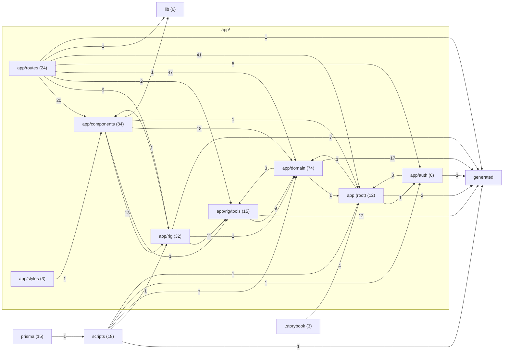

# Topology

<!-- Generated by `npm run topology` (scripts/topology.ts). Do not edit by hand. -->

Imports between the repo's architectural layers, from every `.ts`, `.tsx`
and `.mjs` file git tracks. Edge labels are import counts (type-only
imports included); imports within a layer aren't drawn. Regenerate with
`npm run topology`; `npm run topology -- --check` fails if this file is
stale or the layering rule below is broken.

## Layer graph

## Layers

Files is every tracked file in the layer (Swift, CSS, migrations, …);
Parsed is the subset read for imports. `generated` is gitignored, so it
only appears as an import target.

| Layer            | Files | Parsed |
| ---------------- | ----- | ------ |
| `app/routes`     | 24    | 21     |
| `app/components` | 84    | 67     |
| `app/rig`        | 32    | 32     |
| `app/rig/tools`  | 15    | 14     |
| `app/domain`     | 74    | 71     |
| `app/auth`       | 6     | 6      |
| `app (root)`     | 12    | 11     |
| `app/styles`     | 3     | 1      |
| `lib`            | 6     | 5      |
| `generated`      | 0     | 0      |
| `prisma`         | 15    | 1      |
| `scripts`        | 18    | 16     |
| `.storybook`     | 3     | 3      |
| `ios`            | 27    | 0      |
| `design`         | 5     | 0      |
| `other`          | 32    | 5      |

## Edges

| From             | To               | Imports | Type-only |
| ---------------- | ---------------- | ------- | --------- |
| `app/routes`     | `app/components` | 20      | 1         |
| `app/routes`     | `app/rig`        | 9       | 1         |
| `app/routes`     | `app/rig/tools`  | 2       | 0         |
| `app/routes`     | `app/domain`     | 47      | 3         |
| `app/routes`     | `app/auth`       | 5       | 0         |
| `app/routes`     | `app (root)`     | 41      | 0         |
| `app/routes`     | `lib`            | 1       | 0         |
| `app/routes`     | `generated`      | 1       | 0         |
| `app/components` | `app/rig`        | 13      | 4         |
| `app/components` | `app/rig/tools`  | 1       | 1         |
| `app/components` | `app/domain`     | 18      | 12        |
| `app/components` | `app (root)`     | 1       | 0         |
| `app/components` | `lib`            | 1       | 1         |
| `app/rig`        | `app/components` | 1       | 1         |
| `app/rig`        | `app/rig/tools`  | 11      | 0         |
| `app/rig`        | `app/domain`     | 2       | 2         |
| `app/rig`        | `generated`      | 7       | 7         |
| `app/rig/tools`  | `app/domain`     | 9       | 0         |
| `app/rig/tools`  | `generated`      | 12      | 11        |
| `app/domain`     | `app/rig/tools`  | 3       | 0         |
| `app/domain`     | `app (root)`     | 1       | 0         |
| `app/domain`     | `generated`      | 17      | 12        |
| `app/auth`       | `app (root)`     | 8       | 0         |
| `app/auth`       | `generated`      | 1       | 1         |
| `app (root)`     | `app/domain`     | 1       | 0         |
| `app (root)`     | `app/auth`       | 1       | 0         |
| `app (root)`     | `generated`      | 2       | 1         |
| `app/styles`     | `app/components` | 1       | 0         |
| `prisma`         | `scripts`        | 1       | 0         |
| `scripts`        | `app/rig`        | 1       | 0         |
| `scripts`        | `app/domain`     | 7       | 0         |
| `scripts`        | `app/auth`       | 1       | 0         |
| `scripts`        | `app (root)`     | 1       | 0         |
| `scripts`        | `generated`      | 1       | 0         |
| `.storybook`     | `app (root)`     | 1       | 0         |

## External packages

| Layer            | Packages (import count)                                                                                                                                                                                                            |
| ---------------- | ---------------------------------------------------------------------------------------------------------------------------------------------------------------------------------------------------------------------------------- |
| `app/routes`     | `@prisma/adapter-better-sqlite3` 1, `node:crypto` 1, `node:fs` 1, `node:os` 1, `node:path` 1, `node:url` 1, `react` 1, `react-router` 8, `vitest` 1                                                                                |
| `app/components` | `@headlessui/react` 2, `@storybook/react-vite` 22, `react` 24, `react-dom` 2, `react-markdown` 1, `react-router` 9, `remark-gfm` 1                                                                                                 |
| `app/rig`        | `@anthropic-ai/sdk` 14, `react` 3, `react-router` 1, `vitest` 13                                                                                                                                                                   |
| `app/rig/tools`  | `@prisma/adapter-better-sqlite3` 1, `node:child_process` 1, `node:fs` 2, `node:os` 2, `node:path` 2, `vitest` 5                                                                                                                    |
| `app/domain`     | `@prisma/adapter-better-sqlite3` 5, `fflate` 4, `linkedom` 7, `node:child_process` 5, `node:crypto` 2, `node:fs` 9, `node:os` 5, `node:path` 5, `node:url` 4, `vitest` 24, `zod` 10                                                |
| `app/auth`       | `node:crypto` 1, `react-router` 1, `vitest` 3                                                                                                                                                                                      |
| `app (root)`     | `@fontsource/figtree` 1, `@prisma/adapter-better-sqlite3` 1, `@react-router/dev` 1, `@react-router/node` 1, `isbot` 1, `node:crypto` 1, `node:stream` 1, `posthog-node` 2, `react-dom` 2, `react-router` 3, `resend` 1, `vitest` 1 |
| `app/styles`     | `@storybook/react-vite` 1                                                                                                                                                                                                          |
| `lib`            | `react` 2, `vitest` 1                                                                                                                                                                                                              |
| `prisma`         | `dotenv` 1                                                                                                                                                                                                                         |
| `scripts`        | `@anthropic-ai/sdk` 1, `@prisma/adapter-better-sqlite3` 1, `dotenv` 4, `node:child_process` 3, `node:crypto` 1, `node:fs` 8, `node:module` 1, `node:path` 8, `subset-font` 3                                                       |
| `.storybook`     | `@fontsource/figtree` 1, `@storybook/react-vite` 2, `@tailwindcss/vite` 1, `vite` 1                                                                                                                                                |
| `other`          | `@posthog/rollup-plugin` 1, `@react-router/dev` 2, `@tailwindcss/vite` 1, `dotenv` 1, `fontaine` 1, `prisma` 1, `vite` 1, `vitest` 2                                                                                               |

## Layering rule

`app/domain/` is deliberately free of React and of the Anthropic SDK
(README, Layout): it must not import `react`, `react-dom`, `react-router`,
`@anthropic-ai/sdk`, `app/components` or `app/routes` — type-only imports
included.

No violations.
